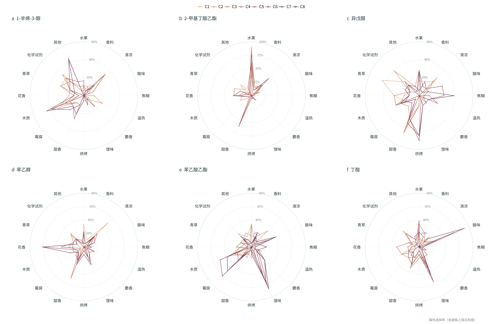
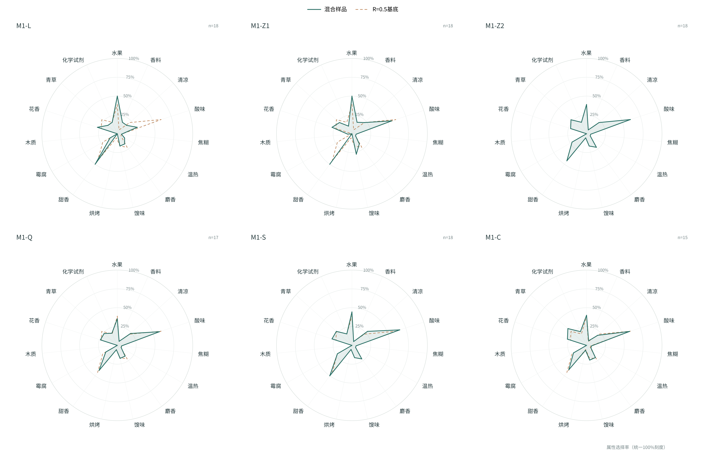
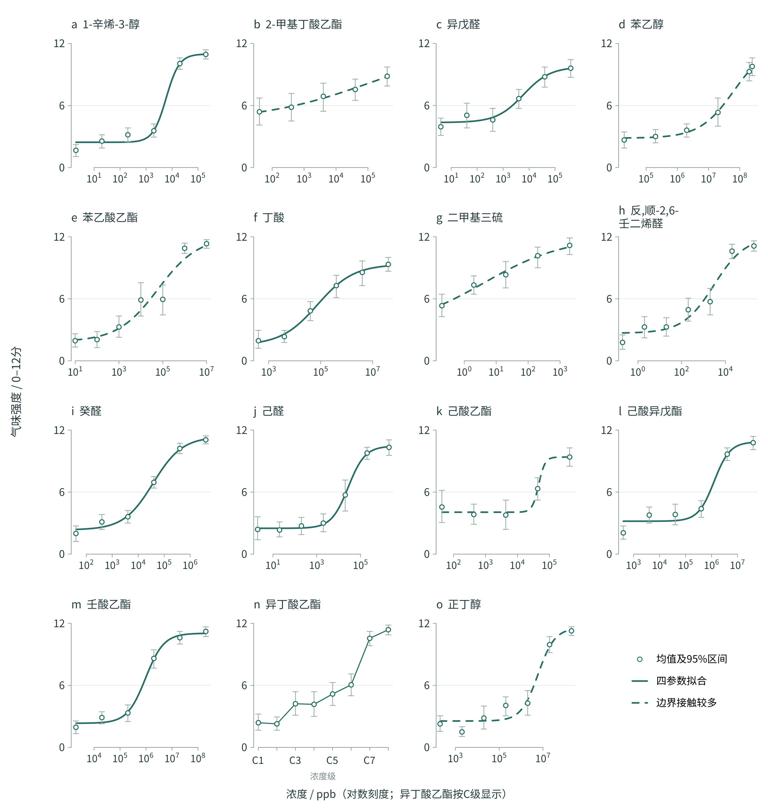

# R感官图视觉修订版 V2（2026-11-23，第2次）

本次目录只新增成图与R制图脚本；不重复上传逐人记录、数据表或统计缓存。原数据沿用已上传的[第1版](../20261123_01_R_model_review_and_radar/)。

- [完整16页图册](Sensory_R_Figures_Design_V2_20261123.pdf)
- [全部矢量图与制图脚本](Sensory_R_Design_V2_Figures_Only.zip)：仅图形与代码，不含数据记录。
- [R视觉重绘脚本](restyle_sensory.R)：运行所需inputs和tables沿用第1版图源包。

新版使用陶色至紫褐色连续浓度色阶、浅灰圆环、青绿样品轮廓及铜色基底对照；图例集中排列，15种单体响应采用4×4布局。雷达刻度用百分比表达，混合样属性顺序统一为原始表顺序。所有统计量与第1版相同。

